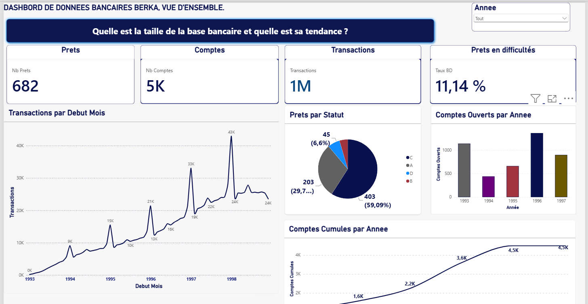
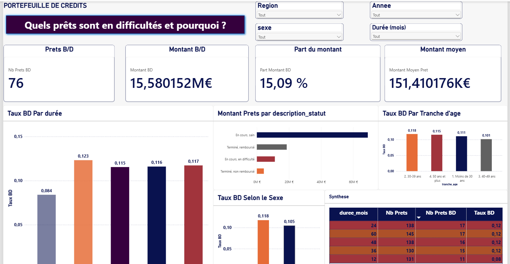
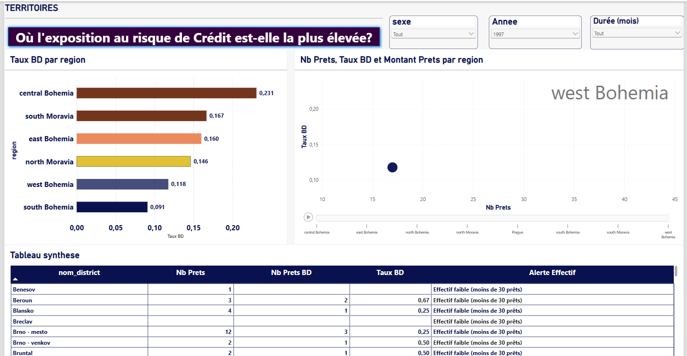
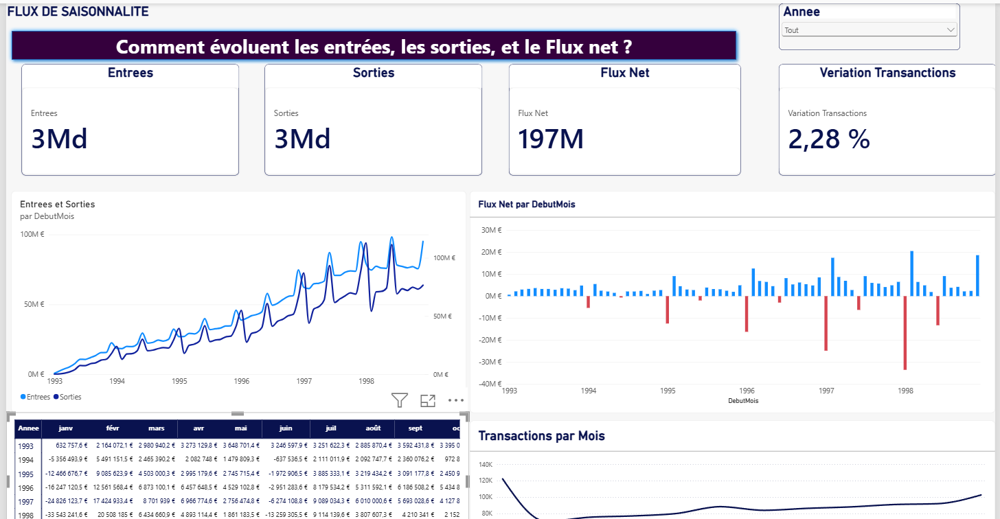
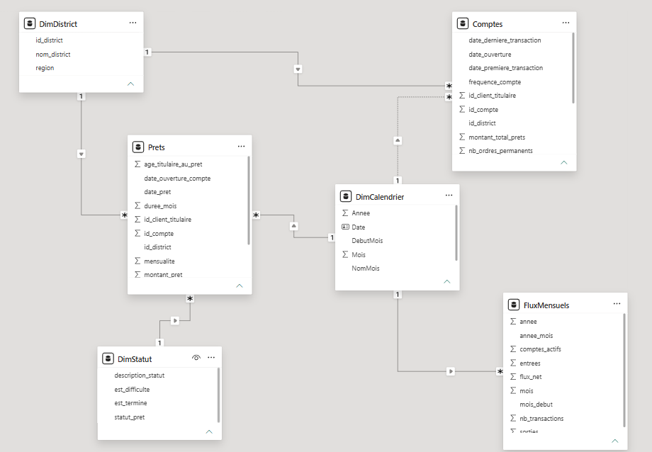

# Tableau de bord Power BI d'une base bancaire (Berka)

Projet 3 du portfolio Data Analyst : un tableau de bord Power BI branché sur la base MySQL `berka` construite au [projet 2 (analyse SQL)](https://github.com/Leonard10-source/analyse-bancaire-berkasql). Il expose la taille de la base bancaire, l'exposition au risque de crédit et la dynamique des flux, avec des chiffres identiques à ceux de la couche SQL.

**Rapport complet** : [docs/Rapport_Projet3_Dashboard_PowerBI_Berka.pdf](docs/Rapport_Projet3_Dashboard_PowerBI_Berka.pdf) (15 pages)

## Aperçu

| Vue d'ensemble | Portefeuille de crédit |
|---|---|
|  |  |
| **Territoires** | **Flux et saisonnalité** |
|  |  |

## Questions métier

| Page | Question |
|---|---|
| 1. Vue d'ensemble | Quelle est la taille de la base bancaire et quelle est sa tendance ? |
| 2. Portefeuille de crédit | Quels prêts sont en difficulté et pourquoi ? |
| 3. Territoires | Où l'exposition au risque de crédit est-elle la plus élevée ? |
| 4. Flux et saisonnalité | Comment évoluent les entrées, les sorties et le flux net ? |

## Résultats principaux

- **682 prêts**, dont **76 en statut B ou D (11,14 %)**, soit 15 580 152 de montants initiaux (15,09 % du total) : les prêts en difficulté pèsent plus en montant qu'en nombre.
- Taux de prêts B/D de **8,40 % à 12 mois** et **12,32 % à 24 mois** ; entre 11,5 % et 11,7 % au-delà.
- Selon les régions, de **1,64 %** (North Bohemia) à **15,79 %** (West Bohemia), sur des effectifs de 57 à 129 prêts.
- Flux net de **197 151 288,70** sur 1993-1998 ; les mois de **janvier et de juin sont déficitaires chaque année de 1994 à 1998**, le creux de janvier passant de −5,4 M à −33,5 M.
- Transactions : de 177 en janvier 1993 à 42 940 en janvier 1998.

Les statuts B (terminé, non remboursé) et D (en cours, en difficulté) sont une convention d'analyse, pas une mesure de perte. Voir la section [Limites](#limites).

## Architecture

```
MySQL 8 (base berka, 3 vues)
        │  MySQL Connector/NET, compte en lecture seule
        ▼
Power Query : colonnes en français, types, tranche_age, mois_debut
        ▼
Modèle en étoile : 3 dimensions, 3 tables de faits, 6 relations
        ▼
18 mesures DAX  ──►  4 pages, 37 visuels
```



| Relation | Faits (*) | Dimension (1) | État |
|---|---|---|---|
| 1 | Prets[id_district] | DimDistrict[id_district] | Active |
| 2 | Comptes[id_district] | DimDistrict[id_district] | Active |
| 3 | Prets[statut_pret] | DimStatut[statut_pret] | Active |
| 4 | Prets[date_pret] | DimCalendrier[Date] | Active |
| 5 | FluxMensuels[mois_debut] | DimCalendrier[Date] | Active |
| 6 | Comptes[date_ouverture] | DimCalendrier[Date] | Inactive (activée par `USERELATIONSHIP`) |

Les tables de faits ne sont jamais reliées entre elles ; les filtres vont de la dimension vers le fait, à sens unique.

## Contenu du dépôt

```
dashboard-bancaire-berka-powerbi/
├── README.md
├── powerbi/
│   └── Berka_Dashboard.pbix          Fichier Power BI Desktop
├── powerquery/
│   ├── Comptes.pq                    Requêtes M (référence)
│   ├── Prets.pq
│   └── FluxMensuels.pq
├── dax/
│   ├── calendrier.dax                Table de calendrier
│   └── mesures.dax                   Les 18 mesures commentées
└── docs/
    ├── Rapport_Projet3_Dashboard_PowerBI_Berka.pdf
    ├── Architecture_Dashboard_Berka.pdf   Maquettes initiales des pages
    └── images/                       Captures du modèle et des pages
```

## Reproduire le projet

**Prérequis** : Windows, Power BI Desktop, MySQL Connector/NET, et la base `berka` du [projet 2](https://github.com/Leonard10-source/analyse-bancaire-berkasql) avec ses trois vues `v_account_summary`, `v_loan_360` et `v_monthly_flows`.

1. Créer un compte en lecture seule :

   ```sql
   CREATE USER 'berka_reader'@'127.0.0.1' IDENTIFIED BY '<mot_de_passe>';
   GRANT SELECT ON berka.* TO 'berka_reader'@'127.0.0.1';
   ```

2. Ouvrir `powerbi/Berka_Dashboard.pbix`.
3. **Accueil**, **Transformer les données**, **Paramètres de la source de données** : vérifier le serveur (`127.0.0.1:3306`) et la base (`berka`), puis saisir les identifiants dans l'onglet **Base de données**.
4. **Actualiser** et comparer les valeurs avec le tableau de validation du rapport (section 5).

Aucun mot de passe n'est stocké dans le dépôt ni dans le fichier `.pbix`.

## Mesures DAX

| Domaine | Mesures |
|---|---|
| Prêts | Nb Prets, Nb Prets BD, Taux BD, Montant Prets, Montant BD, Part Montant BD, Montant Moyen Pret, Taux BD Portefeuille, Alerte Effectif |
| Flux | Entrees, Sorties, Flux Net, Transactions, Transactions M-1, Variation Transactions |
| Comptes | Nb Comptes, Comptes Ouverts, Comptes Cumules |

Les formules et leur lecture sont dans [dax/mesures.dax](dax/mesures.dax) et dans le rapport (section 4).

## Limites

- Données historiques (1993-1998) d'une banque tchèque : les conclusions ne se transposent pas à une banque actuelle.
- 682 prêts seulement : les taux par région, district ou croisement de segments sont instables. La mesure `Alerte Effectif` signale les sélections de moins de 30 prêts.
- 448 prêts sont encore en cours (statuts C et D) : le taux de défaut final peut différer de 11,14 %.
- Analyse descriptive : aucun lien de cause à effet n'est établi, et aucune règle de décision ne doit reposer sur le sexe ou l'âge.
- Les flux portent sur toute la banque : les filtres région, sexe et durée ne s'appliquent pas aux pages de flux.

## Pistes d'amélioration

- Page « Lecture et fiabilité » dans le rapport Power BI.
- Page d'infobulle (effectifs au survol) et exploration par district.
- Solde avant octroi (vue SQL dédiée) pour enrichir le portefeuille.
- Actualisation planifiée et publication sur le service Power BI.

## Données et crédits

Jeu de données historique **Berka (PKDD'99)**, issu du [CTU Relational Repository](https://relational.fel.cvut.cz/dataset/Financial), utilisé à des fins pédagogiques. Les montants sont exprimés dans l'unité monétaire du jeu de données.

## Auteur

**Léonard AZEKWA MATAKOBA** · Master Intelligence Artificielle et Data Science
